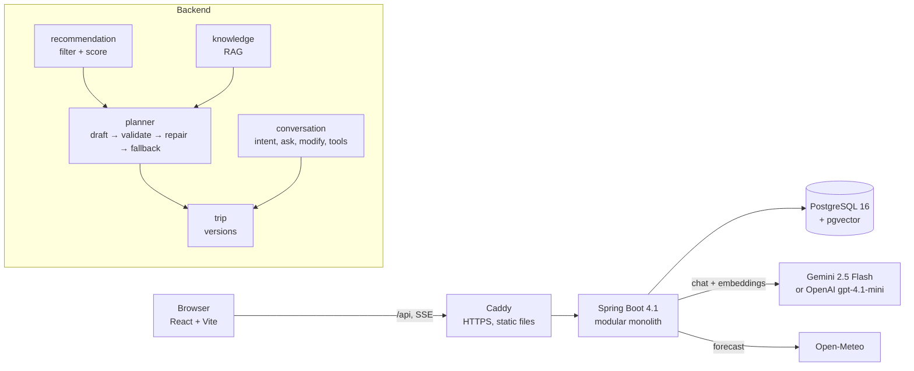

# TravelPilot AI

[](https://github.com/<owner>/travelpilot-app/actions/workflows/ci.yml)

**Tell it who is travelling, where, for how long and on what budget, and you get a day-by-day itinerary you can
trust: real places, real opening hours, ticket prices added up by code, child-age rules enforced, every
suggestion with a reason and a source. You can then change it in plain Vietnamese ("Ngày 2 đổi sang trong nhà")
or ask questions about the trip.**

Destinations: Hà Nội, Đà Nẵng (including Hội An) and Quảng Ninh (Hạ Long), with a curated catalog of 101 places
and 401 knowledge passages.

<!-- Demo GIF: record the form → progress → plan → chat flow and save it as docs/demo.gif -->


## The idea in one sentence: the LLM chooses, the backend computes

Language models are good at choosing and explaining, and bad at facts and arithmetic. So the model only picks
**candidate ids** for each day and slot and writes a short reason. Everything a traveler acts on (names,
prices, hours, travel times, totals, age limits) comes from the catalog and from code. If the model
breaks a rule, the backend tells it exactly what is wrong. If it still fails, a deterministic planner takes over.
A prompt injection can therefore change wording, but it cannot add a place, a price or an 18+ bar to a family trip.

## Architecture



## How it works (8 steps)

1. **Request**: destination, dates, group (child ages), budget for tickets and meals, preferences, pace and up to
   3 notes. It is validated, and invisible or control characters are removed.
2. **Weather**: Open-Meteo forecast per day; rainy days prefer indoor places. If there is no forecast, planning
   continues with a warning.
3. **Hard filter**: wrong destination, too young, too expensive and closed places are removed, each with a
   reason code.
4. **Score**: six weighted components (preference, budget, distance, schedule, group, popularity). The weights
   are in config, and every item shows its breakdown ("Vì sao gợi ý?").
5. **Evidence**: RAG over Wikivoyage, Wikipedia and hand-written tips, filtered by destination (pgvector, HNSW).
6. **Draft**: the model (Gemini or OpenAI) returns JSON with candidate ids per day and slot, a reason and the evidence ids it used
   (`planner-v1`, JSON mode).
7. **Validate → repair → fallback**: 14 rules (unknown id, budget, child age, pace, opening hours, travel time,
   locked days, …). Up to 2 repairs with the exact violations, then a greedy fallback that obeys the same rules.
8. **Assemble**: the backend adds times, prices and the budget total, plus sources and warnings, and saves
   version 1. The UI shows each step live (Server-Sent Events).

After that, the **chat** routes each message:
- A **question** gets a cited answer (RAG + read-only tools: weather, place search, availability).
- A **change** re-plans only the affected days and saves a new version. Old versions stay readable.

## Evaluation

| What | How | Result |
|---|---|---|
| Hard rules on final plans | 20 cases (`be/eval/cases.json`), fixed checks in code | Offline (no model): 10/10 plan cases pass |
| Expectations (must include / exclude, intent, refusal, sources) | same cases | Offline: 8/10 → **9/10** after the first eval-driven fix |
| Real model (schema first try, repair and fallback rate, p50/p95, tokens, cost) | `EvalRunner` + LLM-as-judge (`judge-v1`) | *pending: needs an API key run* |
| Retrieval | 24-question golden set, hit@k and MRR | *pending: needs an API key run* |

The first offline run found a bug that no unit test had caught: the fallback could never schedule Hội An. It is
a 300-minute visit, best in the afternoon, and closes at 17:00. Details and insights are in
[plan/eval-notes.md](plan/eval-notes.md).

## Security (OWASP Top 10 for LLM apps)

- **Guest tokens**: anonymous signed tokens (HS256) instead of accounts. Another guest's trip returns 404.
- **Limits**: rate limits per guest, per IP and per day, plus input caps (2,000-character messages, 32 KB
  bodies) and output-token caps.
- **Untrusted text as data**: notes, chat messages and retrieved passages go into tagged prompt sections. A
  cheap guard refuses obvious injections, and code-level checks (validator, tool allowlist) are the real wall.
- **Tests**: six attack scenarios run in CI (prompt leak, poisoned passage, other guest's trip, forced tool call,
  `<script>`, spam).

Details: [plan/security-notes.md](plan/security-notes.md).

## Cost

Every model call is logged in `ai_call_logs` with its tokens and estimated cost (no prompt text is stored). The
same numbers are exported as metrics (`tp.llm.cost`, `tp.llm.tokens`).

With Gemini 2.5 Flash list prices ($0.30 / $2.50 per 1M input/output tokens), a 3-day plan sends about 3.4k
prompt tokens and gets about 1.5k output tokens. That is **about $0.005 per plan**, and **under $0.015** if two
repairs are needed. This is an offline estimate from the real prompt (`PlanCostEstimateTest`). Measured averages
are at `GET /internal/ai-costs` in the dev profile.

## Run locally (about 10 minutes)

You need Java 21, Node 22, Docker and one AI key: Gemini (free tier at
[Google AI Studio](https://aistudio.google.com/apikey)) or OpenAI ([platform.openai.com](https://platform.openai.com/api-keys)).

```bash
cp .env.example .env            # set AI_PROVIDER + its key, and GUEST_TOKEN_SECRET (any 32+ random characters)
docker compose up -d            # Postgres 16 + pgvector
cd be && ./mvnw spring-boot:run -Dspring-boot.run.profiles=dev -Dspring-boot.run.arguments=--ingest   # API on :8088
# first run seeds 101 places and embeds 401 passages; drop --ingest later
cd fe && npm install && npm run dev        # http://localhost:5173
```

Switching the AI provider is one line in `.env`, then a restart:

| `.env` | Chat | Embeddings | About per 3-day plan |
|---|---|---|---|
| `AI_PROVIDER=google-genai` + `GEMINI_API_KEY` | gemini-2.5-flash | gemini-embedding-001 | $0.005 |
| `AI_PROVIDER=openai` + `OPENAI_API_KEY` | gpt-4.1-mini | text-embedding-3-small | $0.004 |
| same, plus `OPENAI_CHAT_MODEL=gpt-4.1-nano` | gpt-4.1-nano | text-embedding-3-small | $0.001 |

Only the chosen provider needs a key, and the app refuses to start with a clear message if it is missing.
Changing the embedding provider re-embeds the 401 passages once at the next start, because vectors of two models
cannot be compared ([ADR-011](plan/adr/011-switchable-ai-provider.md)).

Or run everything in containers, the way it is deployed:

```bash
cp .env.example .env            # also set DB_PASSWORD
docker compose -f compose.prod.yml up -d --build      # http://localhost
```

## Tests

```bash
cd be && ./mvnw verify            # offline: stub models, no network; DB tests use Testcontainers (Docker)
cd fe && npm run lint && npm test && npm run build
cd be && ./mvnw test -Dgroups=eval -Dtest=OfflineEvalRunner     # eval without a model
cd be && ./mvnw test -Dgroups=eval -Dtest=EvalRunner            # eval with the real model + judge (key + Docker)
cd be && ./mvnw test -Dgroups=eval -Dtest=RetrievalEvalRunner   # retrieval hit@k / MRR (key + Docker)
```

## API

| Method | Path | Purpose |
|---|---|---|
| POST | `/api/v1/guest` | Anonymous guest token; send it as `Authorization: Bearer …` |
| POST | `/api/v1/trips` | Plan a trip → `TripPlan` version 1 |
| POST | `/api/v1/trips/stream` | Same, as Server-Sent Events: `step` events, then `result` or `error` |
| GET | `/api/v1/trips/{id}`, `/api/v1/trips/{id}/versions/{v}` | Read a trip or one version |
| POST/GET | `/api/v1/trips/{id}/messages` | Chat: ask (cited answer) or change (new version); GET = history |
| POST | `/api/v1/ask` | Grounded Q&A without a trip |
| GET | `/api/v1/places`, `/api/v1/places/{id}` | Browse the catalog |
| * | `/internal/**`, `/api/v1/ai/chat`, `/api/v1/trips/candidates` | `dev` profile only |

Errors are RFC 9457 `ProblemDetail` with a `code` and a `requestId`. Every response has an `X-Request-Id`.

## Repository

| Folder | Content |
|---|---|
| `be/` | Java 21, Spring Boot 4.1, Spring AI 2.0 (Gemini or OpenAI), PostgreSQL + pgvector, Flyway |
| `fe/` | React 19, TypeScript, Vite, TanStack Query, Tailwind, Leaflet |
| `data/` | Curated catalog, RAG knowledge, golden set (read-only) |
| `plan/` | Plan, architecture, ADRs, security notes, eval notes, learning log |

## Decisions (ADRs)

| ADR | Decision |
|---|---|
| [001](plan/adr/001-spring-versions.md) | Spring Boot 4.1.2 + Spring AI 2.0.2 |
| [002](plan/adr/002-modular-monolith.md) | One modular monolith |
| [003](plan/adr/003-pgvector-and-embeddings.md) | pgvector, gemini-embedding-001 at 768 dimensions |
| [004](plan/adr/004-llm-chooses-ids.md) | The LLM only chooses candidate ids |
| [005](plan/adr/005-workflow-not-agent.md) | Fixed workflow, not an autonomous agent |
| [006](plan/adr/006-budget-in-backend.md) | Money is computed by the backend |
| [007](plan/adr/007-bounded-tool-loop.md) | Bounded tool loop for chat tools |
| [008](plan/adr/008-guest-token.md) | Anonymous guest tokens |
| [009](plan/adr/009-destinations.md) | Destinations, curated catalog, budget scope |
| [010](plan/adr/010-repair-and-fallback.md) | Validate, repair at most twice, deterministic fallback |
| [011](plan/adr/011-switchable-ai-provider.md) | One switch between Gemini and OpenAI |

Future idea (design only): [blockchain membership](plan/future-membership.md).

## Data attribution

Map data and tiles © OpenStreetMap contributors (ODbL). Guide content from Wikivoyage and Wikipedia
(CC BY-SA 4.0). Weather by Open-Meteo (CC BY 4.0). Destination photographs from Wikimedia Commons (CC BY and
CC BY-SA), credited in the home page footer and in `fe/public/photos/credits.json`. Roboto is self-hosted
(`@fontsource/roboto`, OFL). See [data/ATTRIBUTION.md](data/ATTRIBUTION.md).
